<p align="center">
  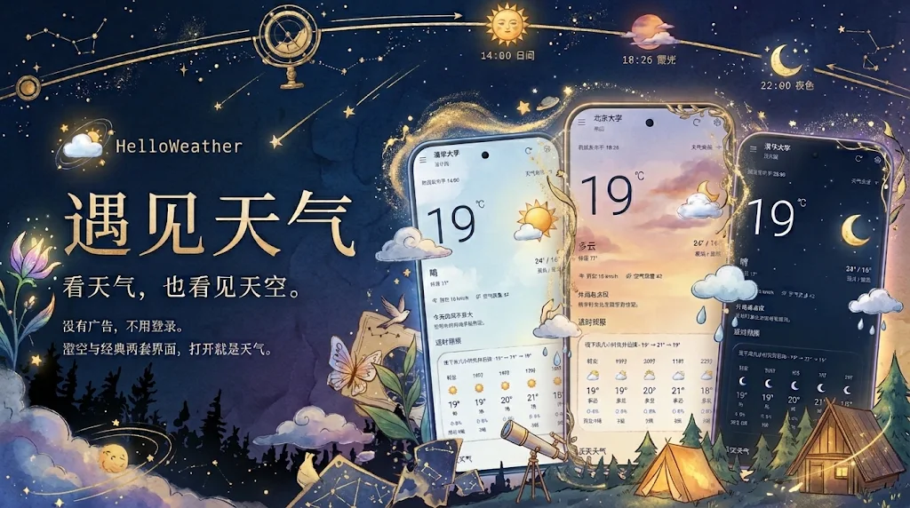
</p>

<p align="center">
  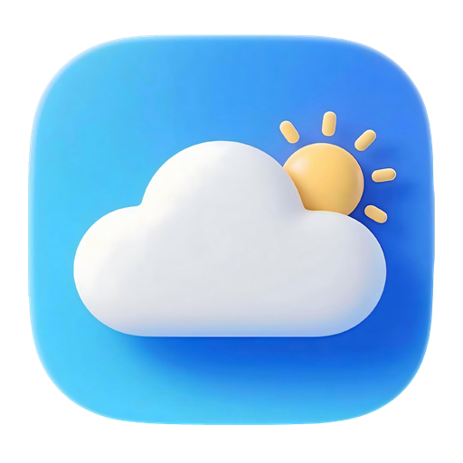<br/>
  <b>Open it, and there's the weather.</b><br/>
  A high-information-density Android weather app in a phosphor terminal style. No ads, no accounts, no analytics SDK.
</p>

<p align="center">
  <a href="https://github.com/Vxiaolong666/HelloMeetWeather/releases/latest"></a>
  <a href="CHANGELOG.md"></a>
  <a href="https://afdian.com/a/hellowather"></a>
</p>

<p align="center">
  <a href="https://github.com/Vxiaolong666/HelloMeetWeather/stargazers"></a>
  <a href="https://github.com/Vxiaolong666/HelloMeetWeather/network/members"></a>
  <a href="https://github.com/Vxiaolong666/HelloMeetWeather/issues"></a>
  <a href="https://github.com/Vxiaolong666/HelloMeetWeather/graphs/contributors"></a>
  <a href="https://github.com/Vxiaolong666/HelloMeetWeather/releases/latest"></a>
  <a href="https://github.com/Vxiaolong666/HelloMeetWeather/releases"></a>
</p>

<p align="center">
  
  
  
  
</p>

<p align="center">
  <a href="README.md">简体中文</a> · <b>English</b>
</p>


<p align="center">
  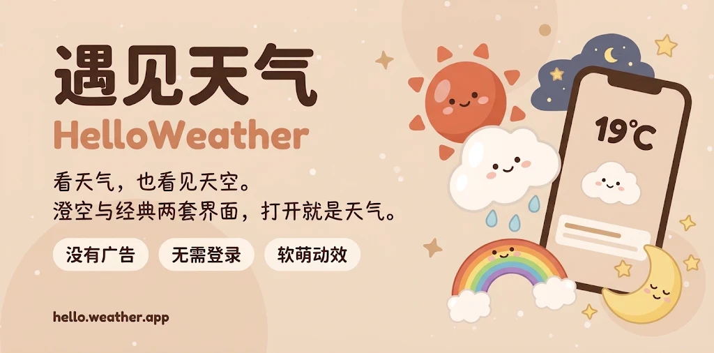
</p>

## Screenshots

<table>
  <tr>
    <td align="center"><a href="assets/s1.jpg">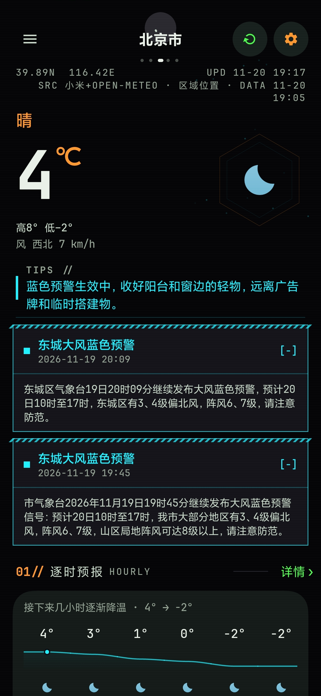</a></td>
    <td align="center"><a href="assets/s4.jpg">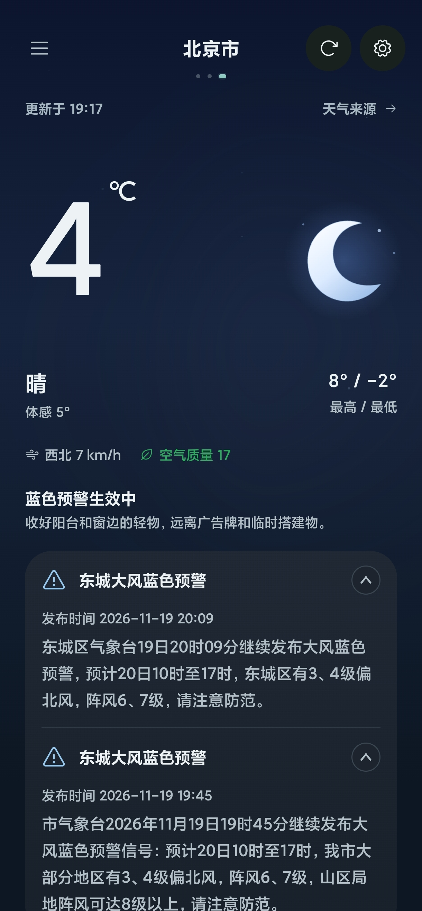</a></td>
    <td align="center"><a href="assets/s2.jpg">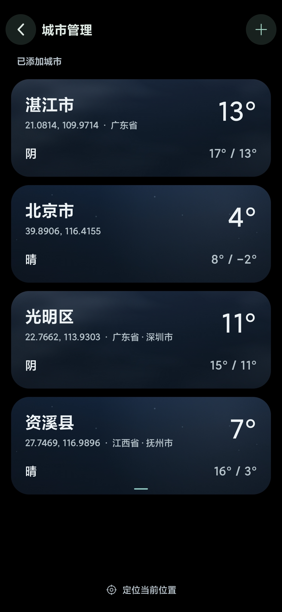</a></td>
    <td align="center"><a href="assets/s5.jpg">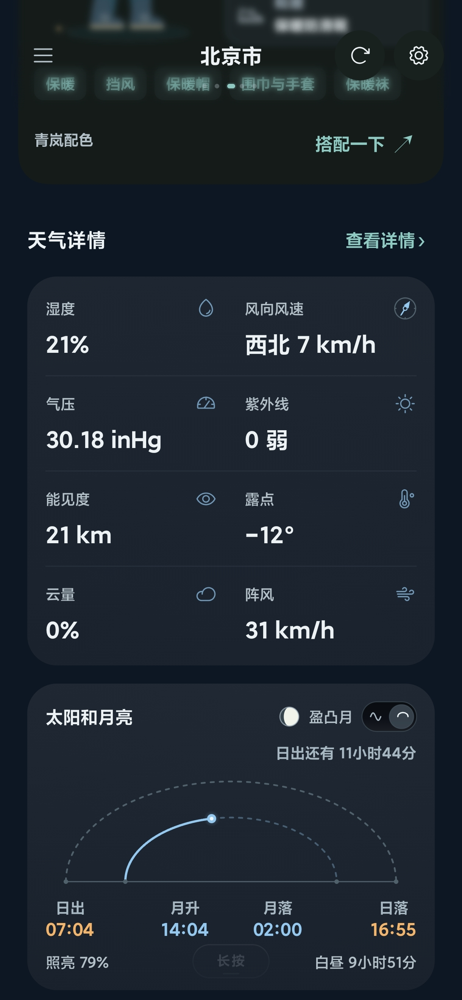</a></td>
    <td align="center"><a href="assets/s3.jpg">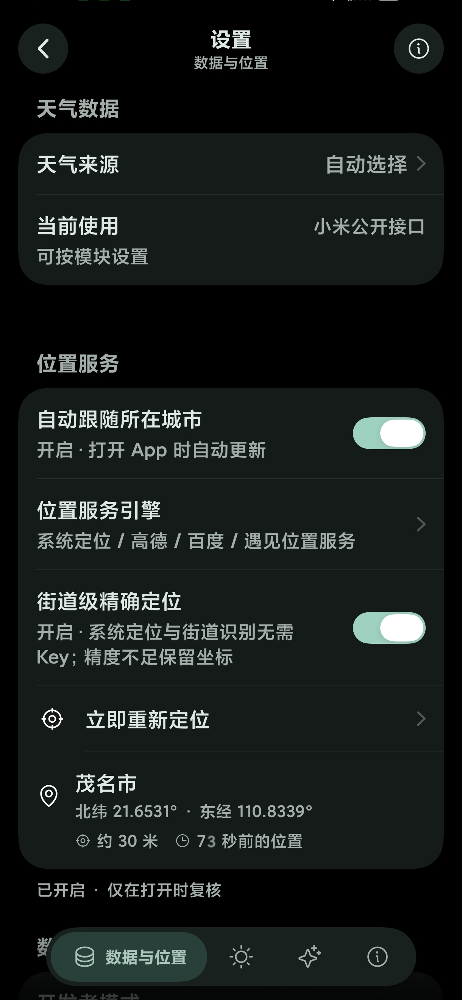</a></td>
  </tr>
  <tr>
    <td align="center"><sub>Terminal home</sub></td>
    <td align="center"><sub>Modern home</sub></td>
    <td align="center"><sub>City list</sub></td>
    <td align="center"><sub>Telemetry and air quality</sub></td>
    <td align="center"><sub>Settings</sub></td>
  </tr>
</table>

<table>
  <tr>
    <td align="center"><a href="assets/a1.jpg">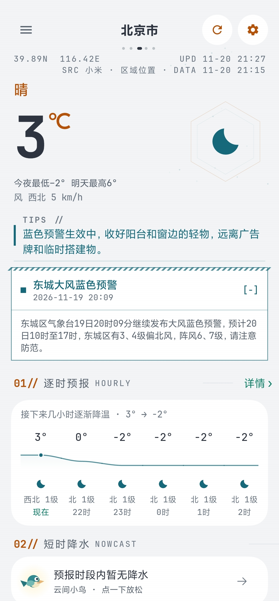</a></td>
    <td align="center"><a href="assets/a2.jpg">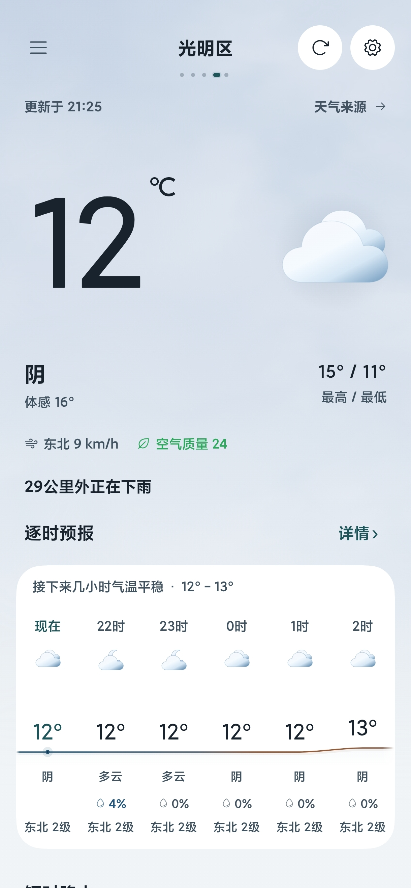</a></td>
    <td align="center"><a href="assets/a3.jpg">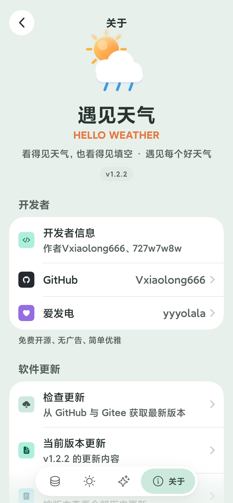</a></td>
    <td align="center"><a href="assets/a4.jpg">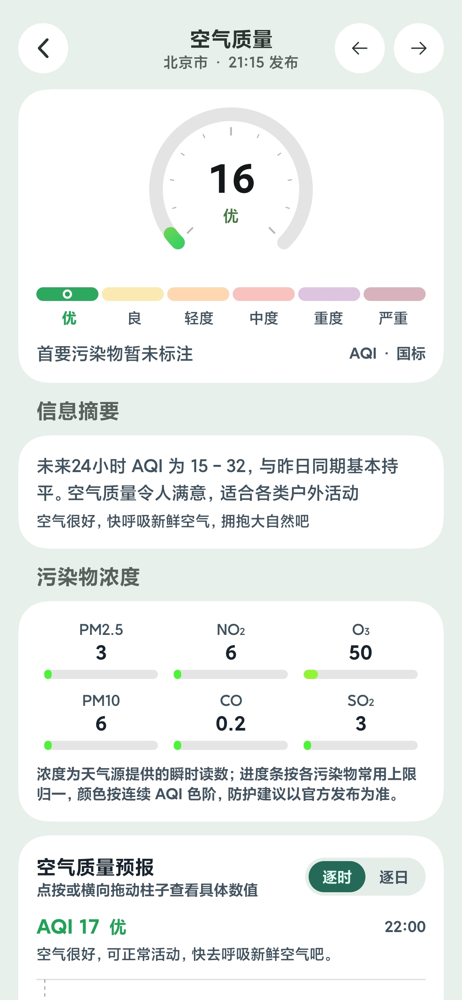</a></td>
    <td align="center"><a href="assets/a5.jpg">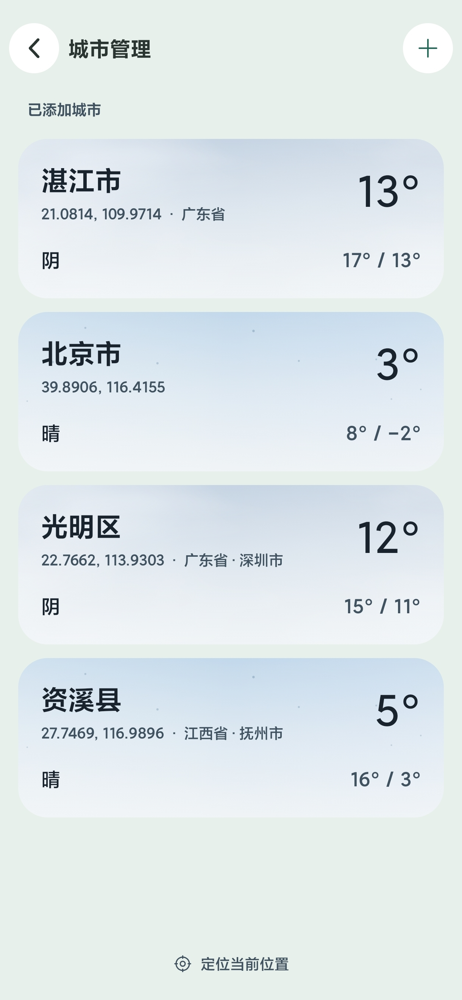</a></td>
  </tr>
    <tr>
    <td align="center"><a href="assets/a6.jpg">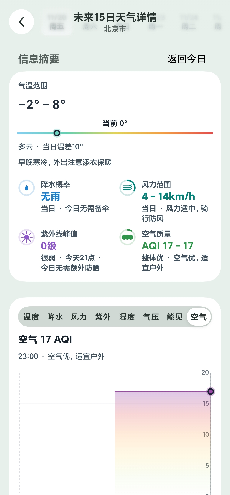</a></td>
    <td align="center"><a href="assets/a7.jpg">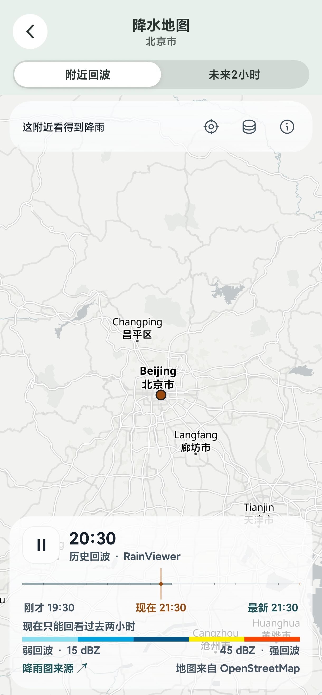</a></td>
    <td align="center"><a href="assets/a8.jpg">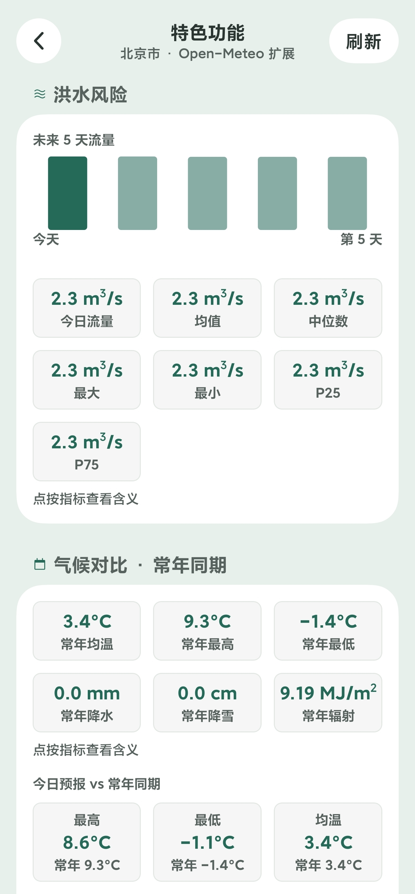</a></td>
    <td align="center"><a href="assets/a9.jpg">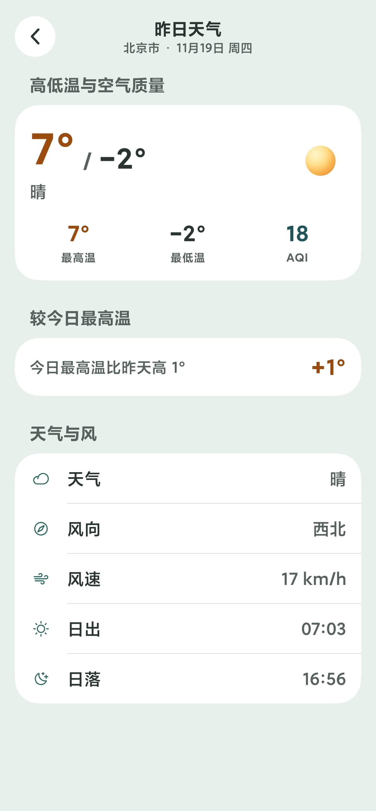</a></td>
    <td align="center"><a href="assets/a10.jpg">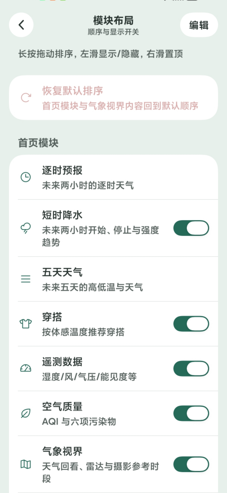</a></td>
  </tr>
</table>

<p align="center"><sub>Click any screenshot to view the full-size image.</sub></p>

## About This Project

HelloMeet Weather is a weather app redeveloped from [ZhishengWeather](https://github.com/zhishengplus/ZhishengWeather) and the [mochi-compose](https://github.com/feice11/mochi-compose) component library.

The original is a phosphor terminal-style weather app: black background, thin-line dividers, cyan as the primary signal, and a few orange accents. Live conditions, alerts, hourly forecasts and short-term precipitation sit up front; scroll down for air quality, life indices and moon phase.

This project builds on the original in two main ways:

1. **Introduced the [Mochi Compose](https://github.com/feice11/mochi-compose) component library**: its soft, springy, finger-following interactions were used to rebuild every page.
2. **Expanded content and experience**: added first-launch onboarding, a location service log, a home-screen update check, bring-your-own provider integration, more life indices, outfit suggestions, detailed air quality and more, with optimized interface animations throughout.

All of the original core capabilities (multi-source weather, terminal ambience, home-screen widgets and multi-city card decks) are preserved, and the data pipeline is unchanged.

## What Changed from the Original

| Change | Details |
|:--|:--|
| Mochi Compose integration | `mochi-compose` and `mochi-icons` are included as local source modules (see `mochi-compose-main/`); only the core library and icon library are used, without the demo or appearance modules |
| Settings and secondary pages rebuilt | The Settings home now uses four bottom tabs: "Data & Location / Home Content / Appearance & Device / About"; About no longer opens a separate page; all secondary pages were rewritten with Mochi grouped lists, row controls and large-title scaffolds |
| Unified page transitions | `AppTransitions` is the single entry point, defaulting to "Open App": a secondary page grows from the tapped source card to full screen and shrinks back along the same path; when no source card exists, a corner container transform is used; switchable in Settings to slide / fade / depth / no animation |
| First-launch onboarding | Six steps — Welcome, Location, Appearance, Motion, Preferences and Finish; skippable at any time and viewable again in Settings |
| Location service log | Settings → Location Services now has a "Location Service Log" page that records every geolocation and reverse-geocoding request, failure reasons and results for troubleshooting |
| Home-screen update check | Checks for updates automatically at startup and manually on demand; when a new version is found, you can view details or ignore that version (no further reminders) |
| Bring-your-own providers | Configure QWeather, Caiyun, AMap, Baidu, Sensibility, Moji and other personal providers in Settings, with guided setup and key management |
| Weather source comparison | A unified dialog and metric cards show differences and levels between sources for an intuitive comparison |
| Life indices and outfit | Added more indices beyond the original set, with cards laid out automatically by the actual count; a new `OutfitSheet` suggests clothing based on the day's weather |
| Air quality enhancements | The air quality page was rebuilt with a more complete six-pollutant breakdown; added a national AQI ranking from the Ministry of Ecology and Environment; the AQI gauge now uses a continuous color-gradient arc |
| Feature hub and sea conditions | Added a feature hub (`FeatureHubScreen`) and extended sea-condition data display |
| Mini-game enhancements | The built-in SkyBird mini-game has enhanced gameplay and motion |
| Liquid Glass | The background glass effect now uses the official Maven artifact `io.github.kyant0:backdrop` instead of bundling a local vendored module |

The build configuration was updated accordingly: Kotlin 2.3, compileSdk 36, and matching Gradle Wrapper and dependency versions.

<p align="center">
  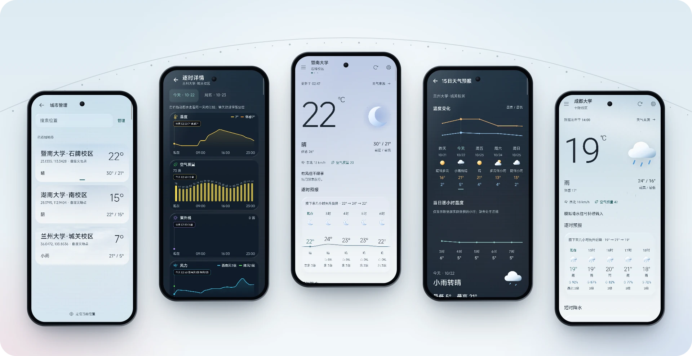
</p>

<p align="center"><sub>City management · Hourly details · Home · 15-day forecast · Rainy home</sub></p>

<p align="center">
  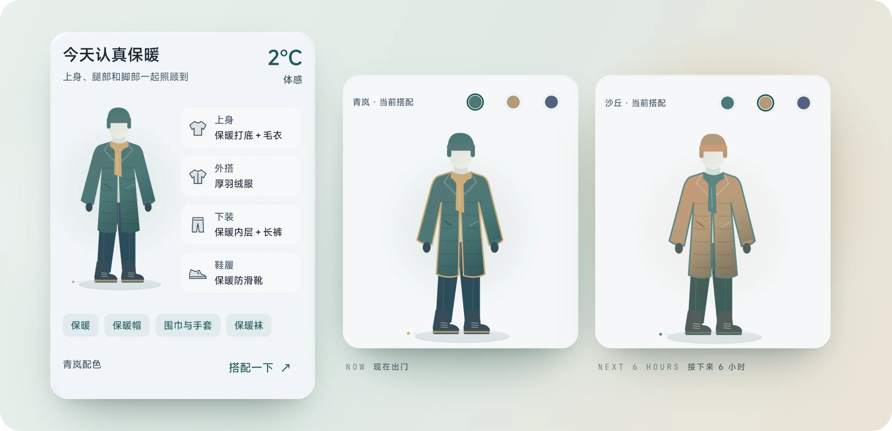
</p>
<p align="center"><sub>The home-page outfit module considers feels-like temperature, wind, rain, snow, gusts, UV and alerts, then combines the current or next six hours of warm/cool trend to put together a top, outer layer, bottoms and shoes. Three color schemes switch instantly; items of similar thickness can be swapped; activity level and warm/cool preference are adjustable. It appears on both home-page styles, can be reordered or hidden, and uses only weather data already fetched — no extra network requests.</sub></p>


## What You Can See

Capabilities inherited from the original:

- Live conditions, feels-like temperature, wind direction and speed, and pressure for your current location or saved cities
- 24-hour hourly forecast, 15-day high/low trend, and precipitation for the next two hours
- Weather alerts, six air-quality pollutant readings and life indices
- Sunrise and sunset, moon phase, moonrise and moonset, plus yesterday's weather comparison
- Multi-city favorites; long-press the bottom bar to deal a card deck and swipe through cities
- Customizable order of home-page weather modules
- Five 3D terminal home-screen widgets: 4x1 / 2x2 / 4x2 / 2x4 / 4x4
- A separate ambient background effect for each weather condition, with adjustable intensity or a full off switch

Temperature, wind speed and pressure units are configured separately; unused page modules can be hidden individually. Fields not provided by a data source are left blank instead of being filled with estimates.

## Icons and Home-screen Shortcuts

The app ships three launcher icon styles — Default, Colorful and Minimal — each with a gradient background, plus monochrome icons on Android 13 and above. Switch them at Settings → Appearance & Device → App Icon. The weather icons are a set of 15 scenes drawn for this project, covering sunny, partly cloudy, overcast, fog, rain, thunder, snow, wind, hail and more. Home-screen shortcuts support refresh, search city and open settings.

## How Data Sources Work

The project integrates QWeather, Caiyun, Xiaomi's public weather API, Open-Meteo, and a separate public typhoon-track feed from the Zhejiang Provincial Department of Water Resources. In Settings you can choose automatic best-source selection or pin a specific provider, and the app shows which source actually returned data for the current city.

| Data source | Configuration | Main content |
|:--|:--|:--|
| QWeather | Lab integration, or build-time values in `local.properties` | Live conditions, alerts, hourly and daily forecasts, minute precipitation, air quality and life indices |
| Caiyun | Token entered in Lab | Live conditions, hourly and daily forecasts, minute precipitation, air quality and alerts |
| Xiaomi public weather API | None | China weather, city search, yesterday's weather and typhoon auxiliary data; per-module source and fallback priority can be set separately |
| Open-Meteo | None | Global live conditions, hourly and daily forecasts, air quality, 15-minute precipitation and missing-field fill-in |
| Zhejiang Provincial Department of Water Resources typhoon-track system | None | Northwest Pacific typhoon live tracks, center intensity, wind radii and multi-agency forecasts |

Automatic selection treats Xiaomi as primary: the current weather phenomenon and precipitation judgment follow Xiaomi's response, and Open-Meteo only fills fields Xiaomi did not return; it switches to Open-Meteo only when the entire Xiaomi request fails. QWeather and Caiyun are not part of the automatic chain and are used only when locked in developer mode. Hourly and daily data are aligned by city hour and local date; existing primary values (including zero precipitation) are never overwritten, and the sources that contributed to a field are visible in the data-source label. Moon phase is calculated locally from the selected city's date; when a source does not provide moonrise or moonset, the app estimates them from the date and coordinates without making another request.

QWeather uses Ed25519-signed JWT, and an API KEY is also accepted. Public builds forcibly clear compile-time credentials; credentials entered in Lab stay on the device only and are never included in backups or the APK.

## Public Build and Installation

GitHub Releases publishes only the official public-release APK; regular users need just that one package and no credential setup: it uses the public data chain, while optional sources such as QWeather and Caiyun can be configured in the app's Lab and are stored only locally. The `release`, `performance` and `previewPublic` variants in the repository are for development, device upgrades and parallel acceptance, not community release packages. In-app direct updates are enabled only in the official public release, and future versions install over the same package name and signature.

Installation steps:

1. Download the latest public APK from [Releases](https://github.com/Vxiaolong666/HelloMeetWeather/releases/latest).
2. Install it on Android 8.0 or later (you may need to allow installation from this source).
3. On first launch, follow the onboarding to choose location access or add a city manually; existing cities and settings are preserved.

See [CHANGELOG.md](CHANGELOG.md) for the full version history.

## Build from Source

Requires JDK 17, Android SDK 36 and Kotlin 2.3. The repository includes a Gradle Wrapper, and the Mochi component library source modules live in `mochi-compose-main/` and compile together with the main project — no separate checkout is needed.

```bash
git clone https://github.com/Vxiaolong666/HelloMeetWeather.git
cd HelloMeetWeather
```

Without credentials, the build uses the public data chain. To use QWeather as the primary source or the Tianditu basemap, add the following to root `local.properties` (already Git-ignored):

```properties
sdk.dir=<Android SDK path>
qw.host=<API Host>
qw.project_id=<Project ID>
qw.kid=<Key ID>
qw.private_key=<Ed25519 private key, single line>
tianditu.token=<Tianditu mobile Key>
```

## Permissions and Data

| Permission | Purpose |
|:--|:--|
| Network access | Fetch weather and city search data |
| Network state | Check whether the device is online |
| Install apps | Open the system install page after a manually downloaded update; no silent installation |
| Coarse location | Optional; requested only when location is enabled and you actively refresh your position |
| Fine location | Optional; requested when you choose precise location on first launch or enable street-level location |

The app has no ad SDK and requires no account registration. Your city list, settings and personal provider credentials are stored on the device; weather requests send the selected location's coordinates to the current provider. When location is enabled and authorized, repositioning happens only on an active refresh — never in the background. The relevant code is in [`app/src/main/kotlin/com/HelloMeet/weather/data`](app/src/main/kotlin/com/HelloMeet/weather/data).

## Contributing

- **Report a bug**: open a [GitHub Issue](https://github.com/Vxiaolong666/HelloMeetWeather/issues) with the version, device model, Android version, current data source, reproduction steps and screenshots; redact tokens, API keys and other credentials before posting.
- **Suggest an idea**: discuss the direction in Discussions first, then open a Feature Request.
- **Send code**: Fork → create a branch → self-test → Pull Request; include before/after screenshots for UI changes. Commit messages should preferably start with `feat`, `fix`, `docs`, `style`, `refactor` or `chore`.

See [CONTRIBUTING.md](CONTRIBUTING.md) for detailed conventions.

## Known Limitations

- No QWeather credentials are bundled by default; configure them in Lab if needed, and official alerts and life indices depend on account permissions
- Open-Meteo's short-term precipitation has 15-minute granularity, not true per-minute radar nowcasting
- Typhoon tracks use a separate official public feed and keep the last valid cache; expired data is clearly labeled
- Cross-source alerts are deduplicated by title, so the same alert with a different title may appear more than once
- For disaster-prevention decisions, always defer to your local meteorological authority

## Support the Creator

If this project is useful to you, consider supporting ongoing development and maintenance via Afdian:

- Afdian: [@yyyolala](https://afdian.com/a/hellowather)

Support is entirely voluntary and does not affect any feature.

## Acknowledgments

This project is a redevelopment built on the work of several excellent open-source projects. Thanks to their authors:

- **[ZhishengWeather](https://github.com/zhishengplus/ZhishengWeather)** — the foundation of this project, MIT licensed. The original UI design, data pipeline, terminal ambience and home-screen widgets all come from it.
- **[mochi-compose](https://github.com/feice11/mochi-compose)** — the library used for the Settings and secondary-page rebuild, Apache 2.0 licensed. The soft, springy, finger-following interactions come from it.
- **[yunsong-weather](https://github.com/SIAKNG/yunsong-weather)** — layout and interaction reference for some pages.
- [Kyant0/Capsule](https://github.com/Kyant0/Capsule) — the shape library used by Mochi.
- [Kyant0/Backdrop](https://github.com/Kyant0/Backdrop) — the Liquid Glass background effect.
- [MapLibre Native Android](https://github.com/maplibre/maplibre-native-android) — map rendering.
- [Ionicons](https://ionic.io/ionicons) (MIT) — icons used by the Mochi icon library.
- [commons-suncalc](https://github.com/shred/commons-suncalc) — sun and moon rise/set calculations.

Weather data copyright belongs to [QWeather](https://www.qweather.com/), [Open-Meteo](https://open-meteo.com/) and the relevant providers of Xiaomi's public weather API. Data is for reference only.

## License

- The original ZhishengWeather code and this project's changes are released under the **MIT License**; see [LICENSE](LICENSE).
- The Mochi Compose library source under `mochi-compose-main/` follows the **Apache License 2.0**, copyright the original library authors, and is integrated here for local compilation only.
- The UI, launcher icons, weather icons and terminal copy are assets of the ZhishengWeather project; please preserve attribution when reusing them.
- If you use QWeather as the primary source, keep your personal credentials safe and never commit them to a public repository.

---

<p align="center"><sub>HelloMeet Weather · Kotlin / Android</sub></p>
