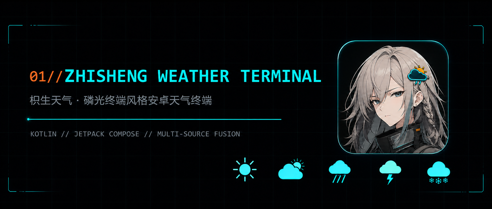
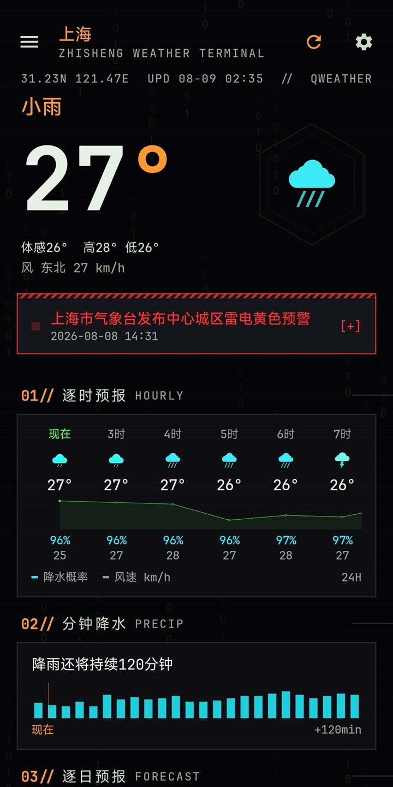
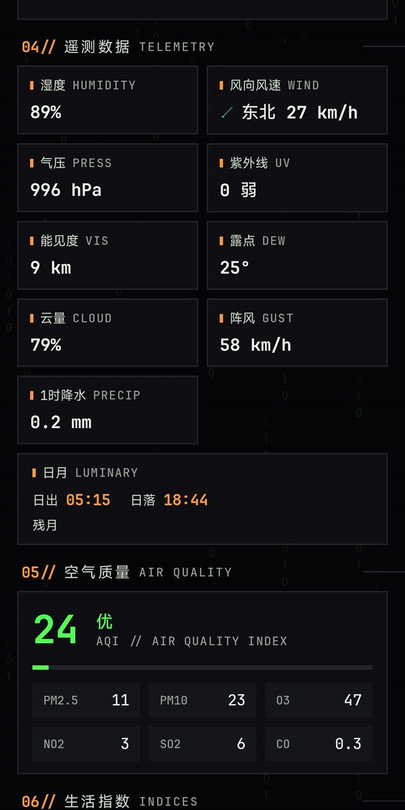
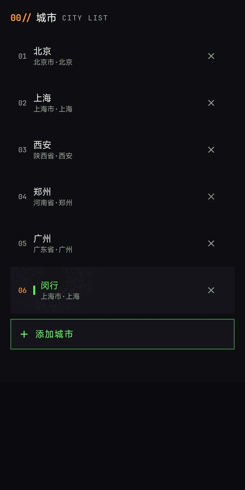
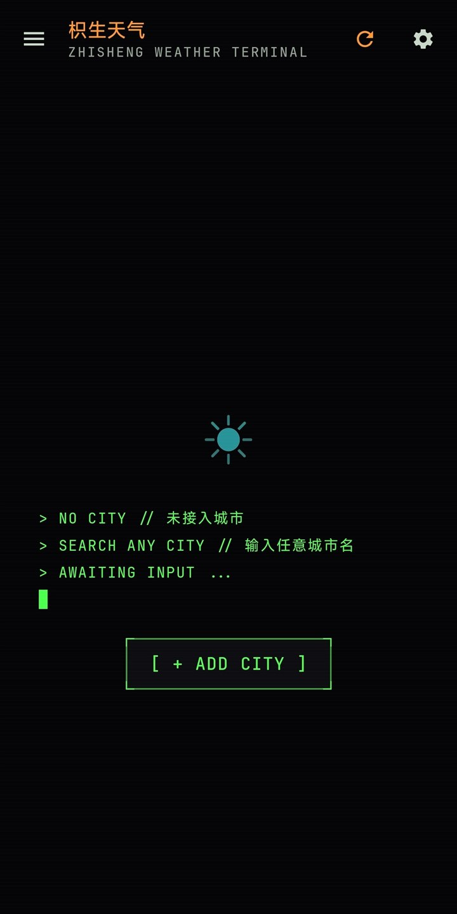
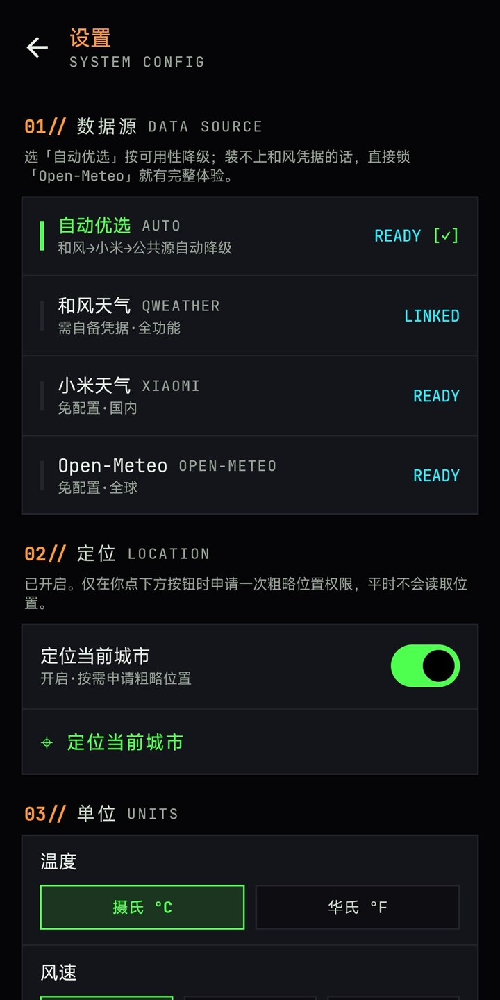

基于 [Z!SHENG WEATHER TERMINAL](https://github.com/zhishengplus/ZhishengWeather)（枳生天气）和组件库 [mochi-compose](https://github.com/feice11/mochi-compose) 二改的天气 APP。

---



<p align="center">
  <br/>
  <b>打开就是天气。</b><br/>
  一款信息密度较高的 Android 天气应用，采用磷光终端风格。没有广告、账号和统计 SDK。
</p>

<p align="center">
  
  
  
  
</p>

<p align="center">
  <b>简体中文</b> · <a href="README.en.md">English</a>
</p>

---

## 界面

<table>
  <tr>
    <td align="center"><a href="assets/screenshot-home.jpg"></a></td>
    <td align="center"><a href="assets/screenshot-details.jpg"></a></td>
    <td align="center"><a href="assets/screenshot-cities.jpg"></a></td>
    <td align="center"><a href="assets/screenshot-add-city.jpg"></a></td>
    <td align="center"><a href="assets/screenshot-settings.jpg"></a></td>
  </tr>
  <tr>
    <td align="center"><sub>主页</sub></td>
    <td align="center"><sub>遥测与空气</sub></td>
    <td align="center"><sub>城市</sub></td>
    <td align="center"><sub>搜索</sub></td>
    <td align="center"><sub>设置（Mochi 重构版）</sub></td>
  </tr>
</table>

<p align="center"><sub>点击截图查看原图。</sub></p>

## 这个项目

原版 [枳生天气](https://github.com/zhishengplus/ZhishengWeather) 是一款磷光终端风格的天气应用：黑色背景、细线分区、青色主信号和少量橙色提示，实况、预警、逐时和短时降水排在前排，往下滑还有空气质量、生活指数和月相。

本项目在原版基础上做了二次开发，主要方向有两件事：

1. **引入 [Mochi Compose](https://github.com/feice11/mochi-compose) 组件库**，用它的软、弹、跟手交互重做了设置页和各二级页面，并接入侧推式页面转场。
2. **扩充内容**：新增多项生活指数、穿搭建议、特色功能模块和空气质量详情页，界面动画一并优化。

原版的全部核心能力（多源天气、终端氛围效果、桌面小组件、多城市卡组）都保留，数据链路没有改动。

## 相比原版改了什么

| 改动 | 说明 |
|:--|:--|
| Mochi Compose 组件库接入 | 以本地源码模块方式引入 `mochi-compose` 与 `mochi-icons`（见 `mochi-compose-main/`），只接核心库和图标库，不引入 demo 与外观模块 |
| 设置页与二级页面重构 | 设置主页、个性化、自动化设置、天气详情等页面改用 Mochi 的分组列表、行控件和大标题骨架重写 |
| 页面转场与返回手势 | 新增侧推式页面转场（`ScreenTransition`），二级页面侧推返回；可开关的返回卡片主题色高亮 |
| 生活指数扩充 | 在原有生活指数之外新增多项指数，卡片按实际数量自适应排布 |
| 穿搭建议 | 新增穿搭建议面板（`OutfitSheet`），按当日天气给出穿衣参考 |
| 特色功能模块 | 新增特色功能中心（`FeatureHubScreen`），汇聚小工具与扩展内容 |
| 空气质量详情强化 | 空气质量页重做，六项分测数据展示更完整 |
| 海况扩展数据 | 补充海况相关扩展数据的展示 |
| 小游戏增强 | 内置 SkyBird 小游戏玩法与动效增强 |
| Liquid Glass 替换 | 背景玻璃效果改用官方 Maven 构件 `io.github.kyant0:backdrop:1.0.6`，不再打包本地 vendored 模块 |

构建配置同步调整：Kotlin 升级到 2.3、compileSdk 36，Gradle Wrapper 与依赖版本相应更新。

## 能看什么

继承自原版的能力：

- 当前位置或已保存城市的实况天气、体感温度、风向风速和气压
- 24 小时逐时预报、15 天高低温趋势，以及未来两小时降水
- 气象预警、空气质量六项分测和生活指数
- 日出日落、月相、月出月落和昨日天气对比
- 多城市收藏，底部长按后可用发牌式卡组连续滑选
- 首页天气模块可自定义顺序
- 4x1 / 2x2 / 4x2 / 2x4 / 4x4 五种 3D 终端桌面小组件
- 每种天气各有一套背景氛围效果，强度可调，也可完全关闭

温度、风速和气压单位分别设置；不用的页面模块可以单独隐藏。数据源没有提供的字段会留空，不用估算值补齐。

## 数据源怎么工作

项目接入了和风天气、彩云天气、小米公开天气接口、Open-Meteo，以及独立的浙江省水利厅台风路径公开资料。设置页可以选择自动优选，也可以固定使用某个天气数据源，并会显示当前城市实际返回数据的来源。

| 数据源 | 配置 | 主要内容 |
|:--|:--|:--|
| 和风天气 | 实验室接入，或构建期写入 `local.properties` | 实况、预警、逐时逐日、分钟降水、空气质量、生活指数 |
| 彩云天气 | 实验室填写 Token | 实况、逐时逐日、分钟降水、空气质量、预警 |
| 小米公开天气接口 | 不需要 | 国内天气、城市搜索、昨日天气和台风辅助数据；可另设模块来源与补全优先级 |
| Open-Meteo | 不需要 | 全球实况、逐时逐日、空气质量、15 分钟降水和缺项补充 |
| 浙江省水利厅台风路径系统 | 不需要 | 西北太平洋台风实况路径、中心强度、风圈与多机构预报 |

自动优选以小米天气为主：实况天气现象和降水判断以小米返回为准，Open-Meteo 只补充小米没有返回的字段；仅当小米整次请求失败时才切换到 Open-Meteo。和风与彩云不进入自动链，只在开发者模式锁定后使用。

和风接口使用 Ed25519 签名 JWT，也可填 API KEY。公开版构建会强制清空编译期凭据；用户在实验室填写的凭据只存在本机，不进备份、不进 APK。

## 从源码构建

需要 JDK 17、Android SDK 36 和 Kotlin 2.3。仓库包含 Gradle Wrapper，`mochi-compose-main/` 内含 Mochi 组件库源码模块，随主工程一起编译，不需要单独拉取。

```bash
git clone https://github.com/Vxiaolong666/ZhiWeather-main.git
cd ZhiWeather-main
```

不填写凭据时，构建结果使用公共数据链路。需要和风主源或天地图底图时，在根目录 `local.properties`（已被 Git 忽略）中写入：

```properties
sdk.dir=<Android SDK 路径>
qw.host=<API Host>
qw.project_id=<Project ID>
qw.kid=<Key ID>
qw.private_key=<Ed25519 私钥，单行>
tianditu.token=<天地图移动端 Key>
```

常用构建命令：

```bash
./gradlew assembleDebug                     # Windows：.\gradlew.bat assembleDebug
./gradlew assembleRelease                   # 本地构建，使用 debug 签名
./gradlew assemblePublicRelease             # 无凭据导出版：清空和风凭据
./gradlew assemblePreviewPublic             # 并行验收包，包名带 .preview 后缀
```

主要技术栈：Kotlin 2.3、Jetpack Compose、Mochi Compose 组件库、ViewModel / StateFlow、Retrofit、OkHttp、kotlinx-serialization、DataStore、MapLibre、BouncyCastle 和 commons-suncalc。`minSdk 26`，`targetSdk 34`。

## 权限和数据

| 权限 | 用途 |
|:--|:--|
| 网络访问 | 请求天气和城市搜索数据 |
| 网络状态 | 判断设备是否联网 |
| 安装应用 | 手动下载更新后打开系统安装页，不会静默安装 |
| 粗略位置 | 可选；仅在开启定位并主动重新定位时申请 |
| 精确位置 | 可选；首次定位选择精确位置或主动开启街道级定位时申请 |

应用无广告 SDK，无需注册账号。城市列表、设置和个人天气源凭据保存在本机；天气请求会把所选地点坐标发送给当前数据源。

## 已知限制

- 默认不含和风凭据；可在实验室自行接入，官方预警和生活指数取决于账号权限
- Open-Meteo 的短时降水为 15 分钟粒度，不是逐分钟雷达临近预报
- 台风路径使用独立官方公开资料并保留最近有效缓存，超过时效时会明确提示
- 跨数据源预警按标题去重，标题不同的同一条预警可能重复出现
- 涉及防灾决策时请以当地气象部门信息为准

## 致谢

本项目是在两个优秀开源项目的成果上做的二次开发，感谢原作者：

- **[枳生天气 ZhishengWeather](https://github.com/zhishengplus/ZhishengWeather)** —— 本项目的基础，MIT 许可。原版的界面设计、数据链路、终端氛围效果和桌面小组件均来自该项目。
- **[mochi-compose](https://github.com/feice11/mochi-compose)** —— 设置页与二级页面重构所用的组件库，Apache 2.0 许可。软、弹、跟手的交互体验来自这个库。
- [Kyant0/Capsule](https://github.com/Kyant0/Capsule) —— Mochi 使用的形状库。
- [Kyant0/Backdrop](https://github.com/Kyant0/Backdrop) —— Liquid Glass 背景玻璃效果。
- [MapLibre Native Android](https://github.com/maplibre/maplibre-native-android) —— 地图渲染。
- [Ionicons](https://ionic.io/ionicons)（MIT）—— Mochi 图标库所用图标。
- [commons-suncalc](https://github.com/shred/commons-suncalc) —— 日月升落计算。

天气数据版权归 [和风天气](https://www.qweather.com/)、[Open-Meteo](https://open-meteo.com/) 和小米公开天气接口相关提供方，数据仅供参考。

## 许可

- 原版枳生天气代码与本项目改动基于 **MIT License** 发布，见 [LICENSE](LICENSE)。
- `mochi-compose-main/` 目录内的 Mochi Compose 组件库源码遵循 **Apache License 2.0**，版权归原库作者所有，仅作本地编译集成使用。
- 界面、启动图标、天气图标和终端文案为枳生天气项目素材，引用时请保留来源。
- 使用和风主源时请保管好个人凭据，不要提交到公开仓库。

---

<p align="center"><sub>ZHISHENG WEATHER TERMINAL // PATTERN BLUE · Kotlin / Android</sub></p>
