<p align="center">
  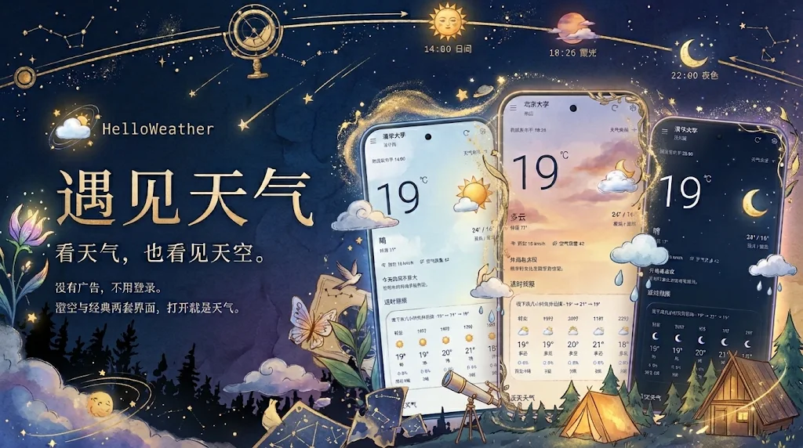
</p>

<p align="center">
  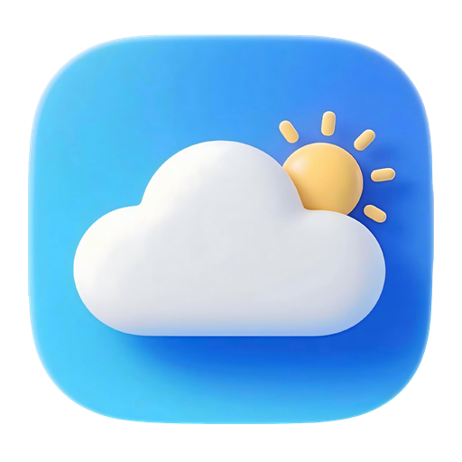<br/>
  <b>打开就是天气。</b><br/>
  一款信息密度较高的 Android 天气应用，采用磷光终端风格。没有广告、账号和统计 SDK。
</p>

<p align="center">
  <a href="https://github.com/Vxiaolong666/HelloMeetWeather/releases/latest"></a>
  <a href="CHANGELOG.md"></a>
  <a href="https://afdian.com/a/hellowather"></a>
</p>

<p align="center">
  <a href="https://github.com/Vxiaolong666/HelloMeetWeather/stargazers"></a>
  <a href="https://github.com/Vxiaolong666/HelloMeetWeather/network/members"></a>
  <a href="https://github.com/Vxiaolong666/HelloMeetWeather/issues"></a>
  <a href="https://github.com/Vxiaolong666/HelloMeetWeather/graphs/contributors"></a>
  <a href="https://github.com/Vxiaolong666/HelloMeetWeather/releases/latest"></a>
  <a href="https://github.com/Vxiaolong666/HelloMeetWeather/releases"></a>
</p>

<p align="center">
  
  
  
  
</p>

<p align="center">
  <b>简体中文</b> · <a href="README.en.md">English</a>
</p>


<p align="center">
  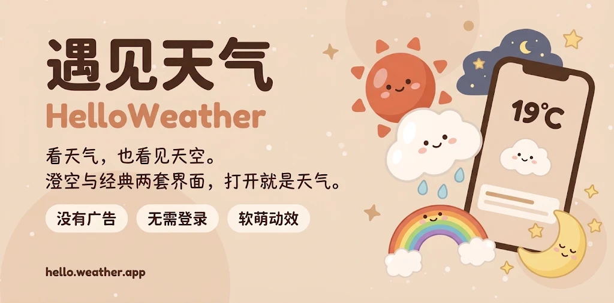
</p>

## 界面

<table>
  <tr>
    <td align="center"><a href="assets/s1.jpg">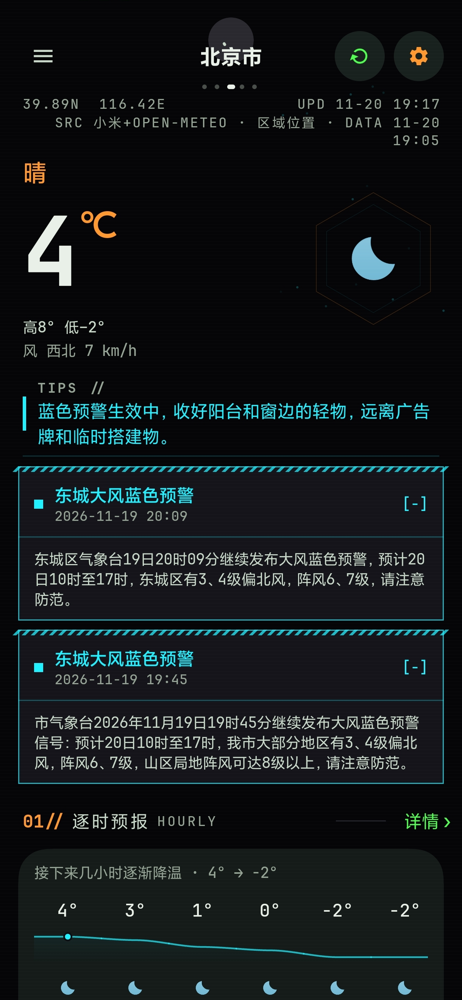</a></td>
    <td align="center"><a href="assets/s4.jpg">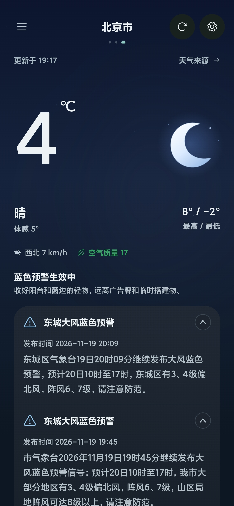</a></td>
    <td align="center"><a href="assets/s2.jpg">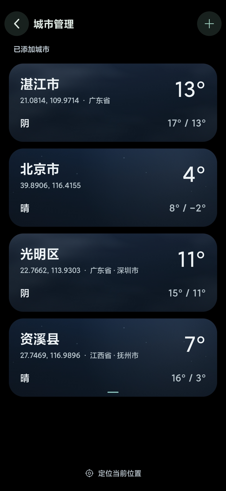</a></td>
    <td align="center"><a href="assets/s5.jpg">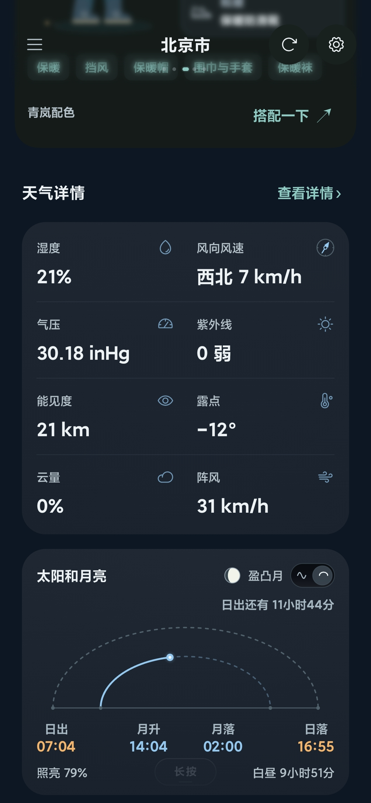</a></td>
    <td align="center"><a href="assets/s3.jpg">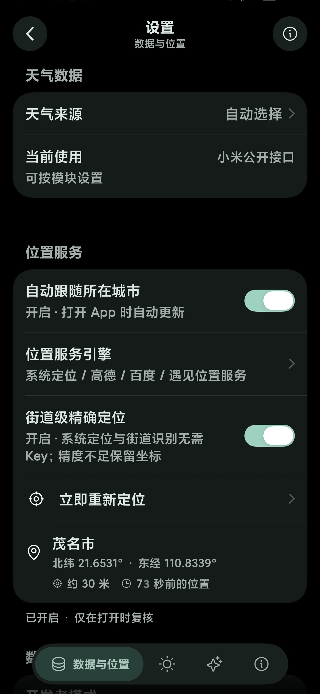</a></td>
  </tr>
  <tr>
    <td align="center"><sub>终端主页</sub></td>
    <td align="center"><sub>现代首页</sub></td>
    <td align="center"><sub>城市列表</sub></td>
    <td align="center"><sub>遥测与空气</sub></td>
    <td align="center"><sub>设置</sub></td>
  </tr>
</table>

<table>
  <tr>
    <td align="center"><a href="assets/a1.jpg">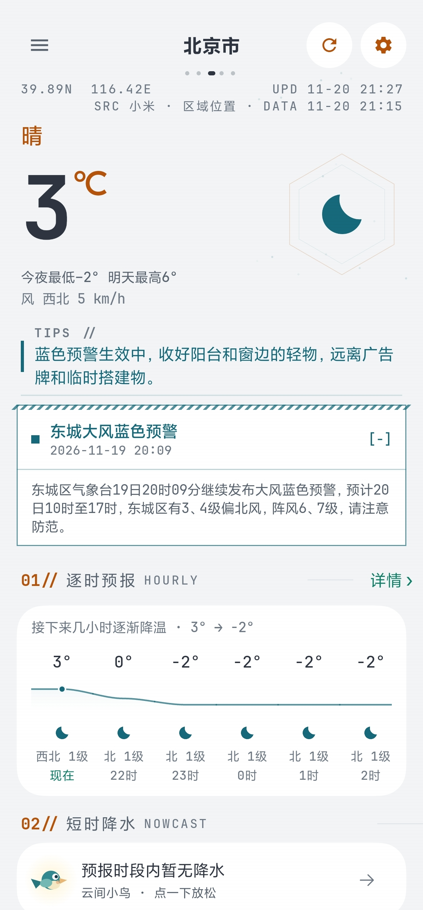</a></td>
    <td align="center"><a href="assets/a2.jpg">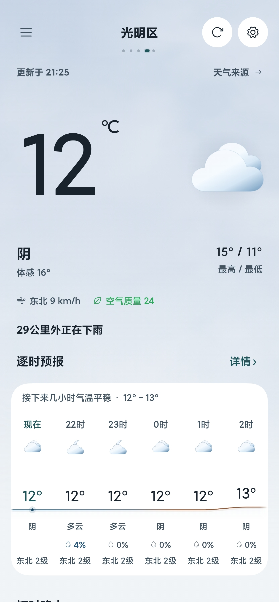</a></td>
    <td align="center"><a href="assets/a3.jpg">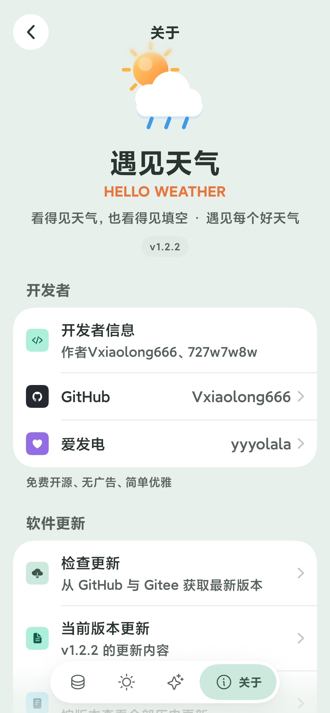</a></td>
    <td align="center"><a href="assets/a4.jpg">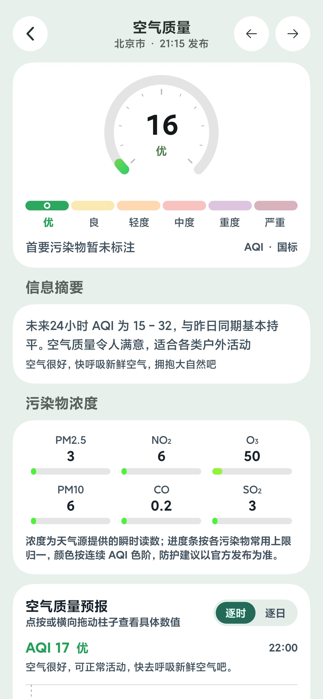</a></td>
    <td align="center"><a href="assets/a5.jpg">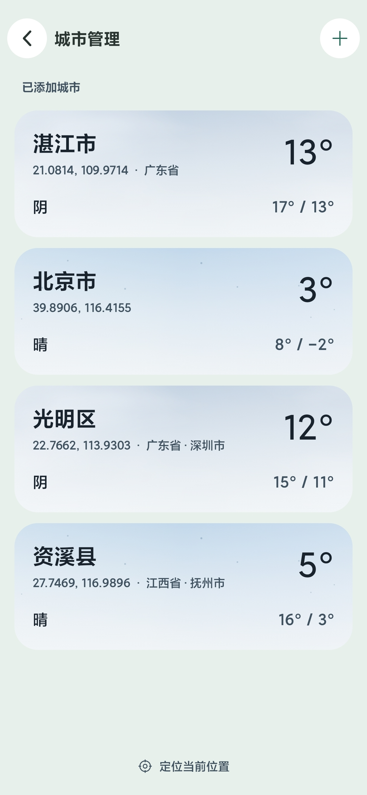</a></td>
  </tr>
    <tr>
    <td align="center"><a href="assets/a6.jpg">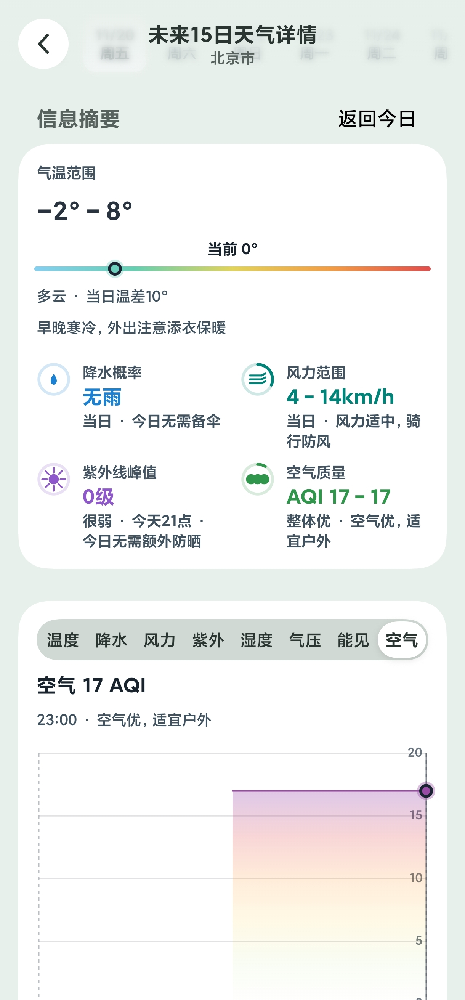</a></td>
    <td align="center"><a href="assets/a7.jpg">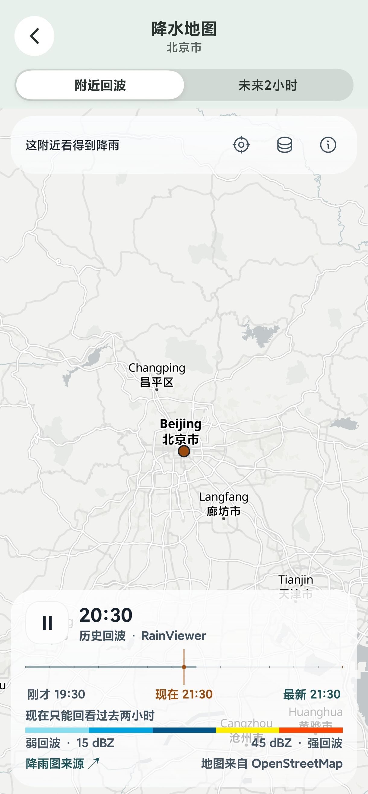</a></td>
    <td align="center"><a href="assets/a8.jpg">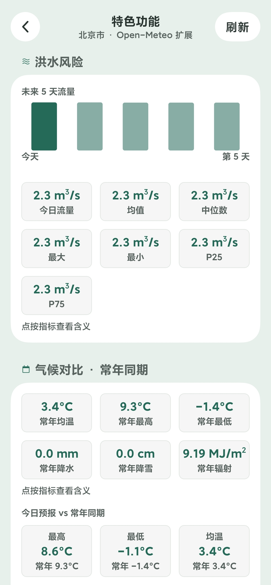</a></td>
    <td align="center"><a href="assets/a9.jpg">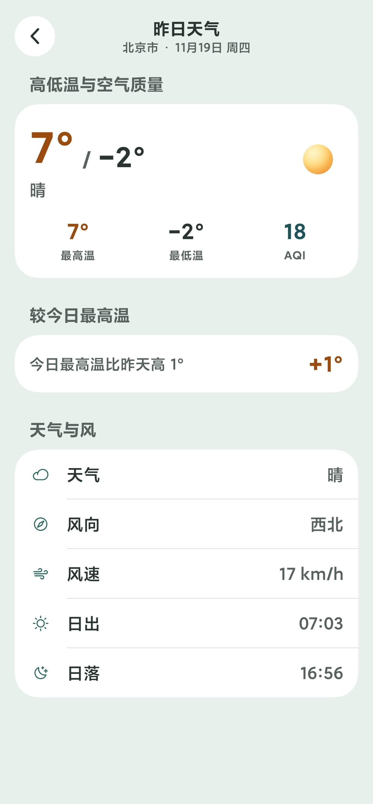</a></td>
    <td align="center"><a href="assets/a10.jpg">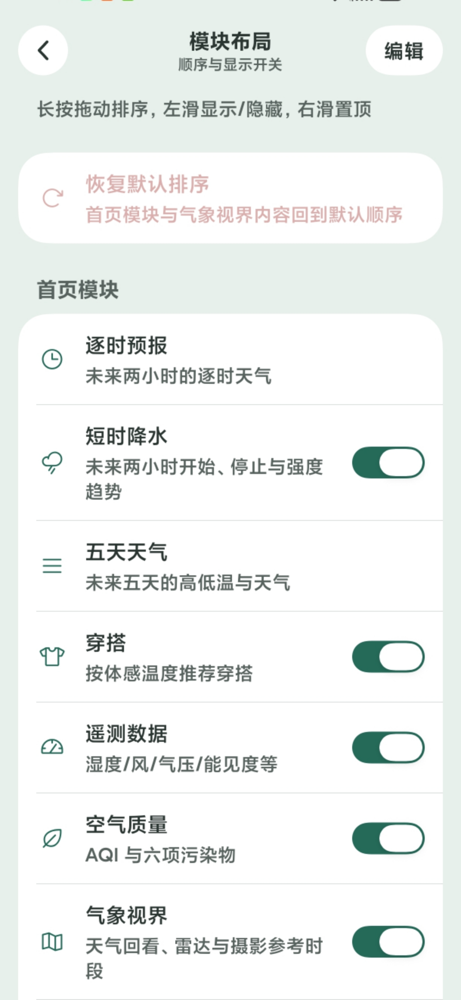</a></td>
  </tr>
</table>

<p align="center"><sub>点击截图查看原图。</sub></p>

## 这个项目

「遇见天气」是基于 [枳生天气（ZhishengWeather）](https://github.com/zhishengplus/ZhishengWeather) 和组件库 [mochi-compose](https://github.com/feice11/mochi-compose) 二次开发的天气应用。

原版是一款磷光终端风格的天气应用：黑色背景、细线分区、青色主信号和少量橙色提示，实况、预警、逐时和短时降水排在前排，往下滑还有空气质量、生活指数和月相。

本项目在原版基础上主要做了两件事：

1. **引入 [Mochi Compose](https://github.com/feice11/mochi-compose) 组件库**：用它的软、弹、跟手交互重做了各页面。
2. **扩充内容与体验**：新增首次启动引导、定位服务日志、首页检查更新、自有服务接入、多项生活指数、穿搭建议、空气质量详情等多维内容，界面动画一并优化。

原版的全部核心能力（多源天气、终端氛围效果、桌面小组件、多城市卡组）都保留，数据链路没有改动。

## 相比原版改了什么

| 改动 | 说明 |
|:--|:--|
| Mochi Compose 组件库接入 | 以本地源码模块方式引入 `mochi-compose` 与 `mochi-icons`（见 `mochi-compose-main/`），只接核心库和图标库，不引入 demo 与外观模块 |
| 设置页与二级页面重构 | 设置主页改为「数据与位置 / 首页内容 / 外观与设备 / 关于」四段式底部标签；关于不再单独开页；各二级页统一用 Mochi 的分组列表、行控件和大标题骨架重写 |
| 统一页面转场 | 以 `AppTransitions` 为唯一入口，默认「打开应用式」：二级页从被点的来源卡片长成整屏、返回原路缩回；无来源卡片时按角落容器变换；可在设置中切换为侧推 / 淡变 / 景深 / 无动画 |
| 首次启动引导 | 欢迎、定位、外观、动效、偏好与完成六步流程，可随时跳过，之后可在设置中重新查看 |
| 定位服务日志 | 设置 → 位置服务新增「定位服务日志」页，记录每次定位与逆地理请求的操作、失败原因与结果，便于排查定位问题 |
| 首页检查更新 | 应用启动时自动检查更新，也可手动检查；发现新版本后可查看详情或忽略该版本，忽略后不再提醒 |
| 自有服务接入 | 设置中可接入和风、彩云、高德、百度、心知、墨迹等自有服务，引导式配置与密钥管理 |
| 天气来源比较 | 统一对话框与指标卡展示各来源差值与等级，直观对比不同数据源 |
| 生活指数与穿搭 | 在原有生活指数之外新增多项指数，卡片按实际数量自适应排布；新增穿搭建议面板（`OutfitSheet`）按当日天气给出穿衣参考 |
| 空气质量强化 | 空气质量页重做，六项分测数据展示更完整；新增生态环境部空气质量全国排名；AQI 仪表盘改用连续色阶渐变弧 |
| 特色功能与海况 | 新增特色功能中心（`FeatureHubScreen`），补充海况扩展数据展示 |
| 小游戏增强 | 内置 SkyBird 小游戏玩法与动效增强 |
| Liquid Glass | 背景玻璃效果改用官方 Maven 构件 `io.github.kyant0:backdrop`，不再打包本地 vendored 模块 |

构建配置同步调整：Kotlin 升级到 2.3、compileSdk 36，Gradle Wrapper 与依赖版本相应更新。

<p align="center">
  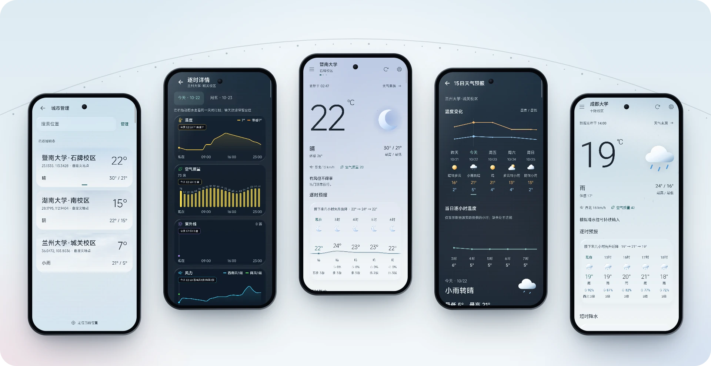
</p>

<p align="center"><sub>城市管理 · 逐时详情 · 首页 · 15 日预报 · 雨天首页</sub></p>

<p align="center">
  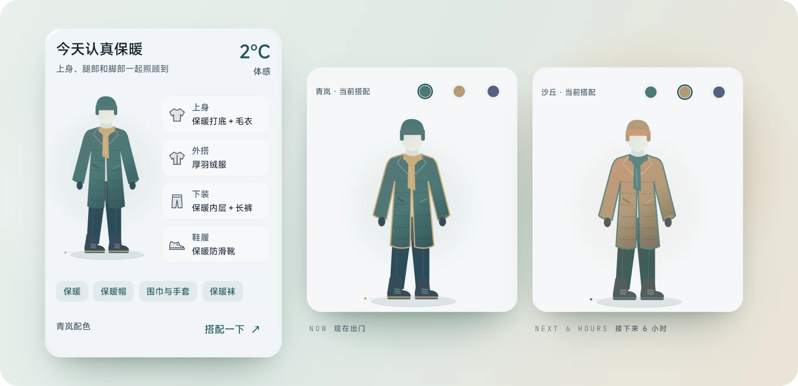
</p>
<p align="center"><sub>主页的穿搭模块会看体感、风雨雪、阵风、紫外线和预警，再结合现在或接下来 6 小时的冷暖，搭好上身、外搭、下装和鞋履。三种配色随手换，同样厚薄的单品可以互换，活动量和冷暖偏好也能调，两套界面的首页都有这个模块，可以排序或隐藏；它只用已经拿到的天气数据，不另外联网。</sub></p>


## 能看什么

继承自原版的能力：

- 当前位置或已保存城市的实况天气、体感温度、风向风速和气压
- 24 小时逐时预报、15 天高低温趋势，以及未来两小时降水
- 气象预警、空气质量六项分测和生活指数
- 日出日落、月相、月出月落和昨日天气对比
- 多城市收藏，底部长按后可用发牌式卡组连续滑选
- 首页天气模块可自定义顺序
- 4x1 / 2x2 / 4x2 / 2x4 / 4x4 五种 3D 终端桌面小组件
- 每种天气各有一套背景氛围效果，强度可调，也可完全关闭

温度、风速和气压单位分别设置；不用的页面模块可以单独隐藏。数据源没有提供的字段会留空，不用估算值补齐。

## 图标与桌面快捷方式

应用内置默认、缤纷、极简三种启动图标样式，各自带渐变背景，Android 13 以上提供单色图标；在「设置 → 外观与设备 → 应用图标」切换。天气图标为本项目绘制的一套 15 个场景图形，覆盖晴、多云、阴、雾、雨、雷、雪、风、冰雹等。桌面快捷方式支持刷新、搜索城市和打开设置。

## 数据源怎么工作

项目接入了和风天气、彩云天气、小米公开天气接口、Open-Meteo，以及独立的浙江省水利厅台风路径公开资料。设置页可以选择自动优选，也可以固定使用某个天气数据源，并会显示当前城市实际返回数据的来源。

| 数据源 | 配置 | 主要内容 |
|:--|:--|:--|
| 和风天气 | 实验室接入，或构建期写入 `local.properties` | 实况、预警、逐时逐日、分钟降水、空气质量、生活指数 |
| 彩云天气 | 实验室填写 Token | 实况、逐时逐日、分钟降水、空气质量、预警 |
| 小米公开天气接口 | 不需要 | 国内天气、城市搜索、昨日天气和台风辅助数据；可另设模块来源与补全优先级 |
| Open-Meteo | 不需要 | 全球实况、逐时逐日、空气质量、15 分钟降水和缺项补充 |
| 浙江省水利厅台风路径系统 | 不需要 | 西北太平洋台风实况路径、中心强度、风圈与多机构预报 |

自动优选以小米天气为主：实况天气现象和降水判断以小米返回为准，Open-Meteo 只补充小米没有返回的字段；仅当小米整次请求失败时才切换到 Open-Meteo。和风与彩云不进入自动链，只在开发者模式锁定后使用。逐时和逐日按同一城市小时 / 当地日期对齐，已有的主源数值（包括降雨量为 0）不会被覆盖，参与补全的来源在数据来源标签里可见。月相在本地按所选城市的日期计算；数据源没有给月出月落时，应用会用日期和坐标推算，不再额外发起请求。

和风接口使用 Ed25519 签名 JWT，也可填 API KEY。公开版构建会强制清空编译期凭据；用户在实验室填写的凭据只存在本机，不进备份、不进 APK。

## 公开版与安装

GitHub Releases 只发布正式公开版 APK，普通用户装这一个包即可，无需配置凭据：它走公共数据链路，和风、彩云等可选源可在应用内「实验室」填写，凭据只存本机。仓库里的 `release` / `performance` / `previewPublic` 变体用于开发、设备升级和并行验收，不是面向社区的发行包；应用内直接更新只在正式公开版启用，后续版本能以相同包名和签名覆盖安装。

安装步骤：

1. 从 [Releases](https://github.com/Vxiaolong666/HelloMeetWeather/releases/latest) 下载最新公开版 APK。
2. 在 Android 8.0 以上设备安装（需要允许当前下载来源安装未知来源应用）。
3. 首次启动按引导选择定位或手动添加城市；已有城市和设置会被保留。

完整版本历史见 [CHANGELOG.md](CHANGELOG.md)。

## 从源码构建

需要 JDK 17、Android SDK 36 和 Kotlin 2.3。仓库包含 Gradle Wrapper，`mochi-compose-main/` 内含 Mochi 组件库源码模块，随主工程一起编译，不需要单独拉取。

```bash
git clone https://github.com/Vxiaolong666/HelloMeetWeather.git
cd HelloMeetWeather
```

不填写凭据时，构建结果使用公共数据链路。需要和风主源或天地图底图时，在根目录 `local.properties`（已被 Git 忽略）中写入：

```properties
sdk.dir=<Android SDK 路径>
qw.host=<API Host>
qw.project_id=<Project ID>
qw.kid=<Key ID>
qw.private_key=<Ed25519 私钥，单行>
tianditu.token=<天地图移动端 Key>
```


## 权限和数据

| 权限 | 用途 |
|:--|:--|
| 网络访问 | 请求天气和城市搜索数据 |
| 网络状态 | 判断设备是否联网 |
| 安装应用 | 手动下载更新后打开系统安装页，不会静默安装 |
| 粗略位置 | 可选；仅在开启定位并主动重新定位时申请 |
| 精确位置 | 可选；首次定位选择精确位置或主动开启街道级定位时申请 |

应用无广告 SDK，无需注册账号。城市列表、设置和个人天气源凭据保存在本机；天气请求会把所选地点坐标发送给当前数据源。开启定位并授权后，只有主动刷新时才会重新定位，不会在后台采集位置。相关代码在 [`app/src/main/kotlin/com/HelloMeet/weather/data`](app/src/main/kotlin/com/HelloMeet/weather/data)。

## 参与贡献

- **报缺陷**：用 [GitHub Issues](https://github.com/Vxiaolong666/HelloMeetWeather/issues) 提交，写清版本、机型、Android 版本、当前数据源、复现步骤和截图；提交前请遮掉 Token、API Key 等凭据。
- **提想法**：先在 Discussions 里讨论方向，再开 Feature Request。
- **交代码**：Fork → 开分支 → 自测 → Pull Request；改动界面请附前后对比截图。提交信息建议带 `feat` / `fix` / `docs` / `style` / `refactor` / `chore` 前缀。
详细约定见 [CONTRIBUTING.md](CONTRIBUTING.md)。

## 已知限制

- 默认不含和风凭据；可在实验室自行接入，官方预警和生活指数取决于账号权限
- Open-Meteo 的短时降水为 15 分钟粒度，不是逐分钟雷达临近预报
- 台风路径使用独立官方公开资料并保留最近有效缓存，超过时效时会明确提示
- 跨数据源预警按标题去重，标题不同的同一条预警可能重复出现
- 涉及防灾决策时请以当地气象部门信息为准

## 支持创作者

如果这个项目对你有帮助，欢迎通过爱发电支持后续开发与维护：

- 爱发电：[@yyyolala](https://afdian.com/a/hellowather)

支持完全自愿，不影响任何功能的正常使用。

## 致谢

本项目是在几个优秀开源项目的成果上做的二次开发，感谢原作者：

- **[枳生天气 ZhishengWeather](https://github.com/zhishengplus/ZhishengWeather)** —— 本项目的基础，MIT 许可。原版的界面设计、数据链路、终端氛围效果和桌面小组件均来自该项目。
- **[mochi-compose](https://github.com/feice11/mochi-compose)** —— 设置页与二级页面重构所用的组件库，Apache 2.0 许可。软、弹、跟手的交互体验来自这个库。
- **[yunsong-weather](https://github.com/SIAKNG/yunsong-weather)** —— 部分页面的布局与交互参考借鉴该项目。
- [Kyant0/Capsule](https://github.com/Kyant0/Capsule) —— Mochi 使用的形状库。
- [Kyant0/Backdrop](https://github.com/Kyant0/Backdrop) —— Liquid Glass 背景玻璃效果。
- [MapLibre Native Android](https://github.com/maplibre/maplibre-native-android) —— 地图渲染。
- [Ionicons](https://ionic.io/ionicons)（MIT）—— Mochi 图标库所用图标。
- [commons-suncalc](https://github.com/shred/commons-suncalc) —— 日月升落计算。

天气数据版权归 [和风天气](https://www.qweather.com/)、[Open-Meteo](https://open-meteo.com/) 和小米公开天气接口相关提供方，数据仅供参考。

## 许可

- 原版枳生天气代码与本项目改动基于 **MIT License** 发布，见 [LICENSE](LICENSE)。
- `mochi-compose-main/` 目录内的 Mochi Compose 组件库源码遵循 **Apache License 2.0**，版权归原库作者所有，仅作本地编译集成使用。
- 界面、启动图标、天气图标和终端文案为枳生天气项目素材，引用时请保留来源。
- 使用和风主源时请保管好个人凭据，不要提交到公开仓库。

---

<p align="center"><sub>遇见天气 · HELLO MEET WEATHER · Kotlin / Android</sub></p>
